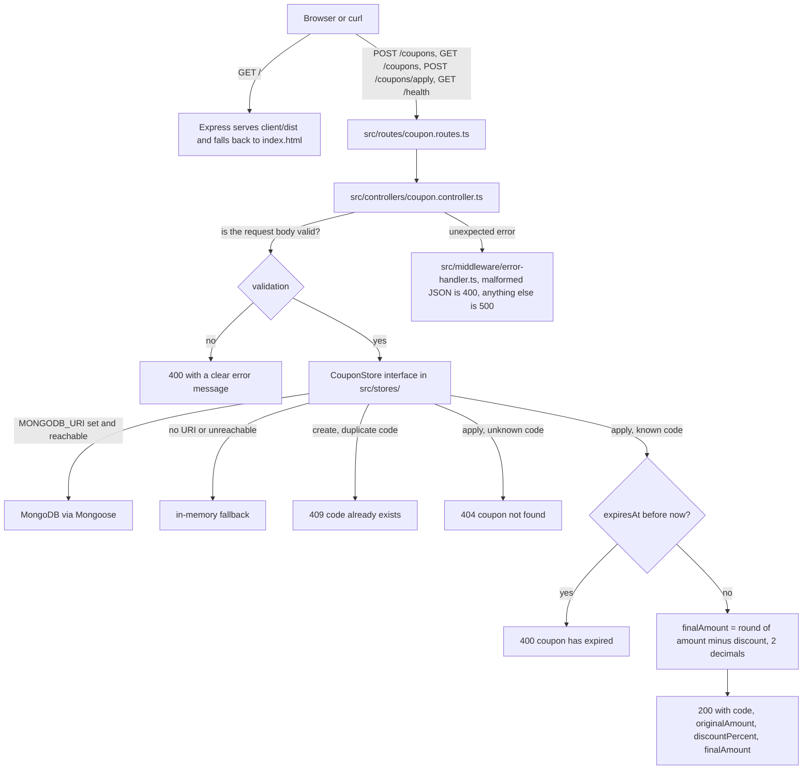

# Coupon API

A small API for creating discount coupons and applying them to an order, built for the Collabroot developer intern task.

Stack: Node.js, Express, TypeScript, MongoDB (with an automatic in memory fallback so it runs with zero setup). A bonus React and Vite page for creating and listing coupons lives in `client/`. The reasoning behind each of these choices, including why Bun and Postgres were not used, is written out in [docs/decisions.md](docs/decisions.md).

## End to end flow

Every request lands in the router, is validated in the controller, goes out through one storage interface, and any throw ends in the one error handler:



The per-file breakdown of the same flow is in [docs/ARCHITECTURE.md](docs/ARCHITECTURE.md).

## Requirements

- Node.js 18 or newer
- npm (comes with Node)
- MongoDB is optional. Without it the API runs on an in memory store automatically.

## Install and run

```bash
npm install
cp .env.example .env
npm run dev
```

The root `npm install` also installs the client's dependencies, so one command sets up both halves. `npm run dev` then builds the React page into `client/dist` and starts the API.

The server starts on `http://localhost:4000` by default. On startup it logs which storage backend it is using:

```
coupon api listening on port 4000
storage backend: in memory (set MONGODB_URI in .env to use MongoDB instead)
```

To use MongoDB instead, set `MONGODB_URI` in `.env` before starting the server, for example:

```
MONGODB_URI=mongodb://127.0.0.1:27017/coupons
```

or an Atlas connection string. If the URI is set but unreachable, the server logs a warning and falls back to in memory storage rather than failing to start.

### Production build

```bash
npm run build
npm start
```

This compiles TypeScript to `dist/`, builds the React page into `client/dist`, and runs the compiled output.

## Running the tests

```bash
npm test
```

This runs the full Jest and Supertest suite (`tests/coupon.test.ts`) against `InMemoryCouponStore`, so no database is needed to run the tests. It covers both successful requests and every error case listed in the task: an unknown coupon code, an expired coupon, and a missing, negative or non numeric amount, plus a body that is not valid JSON.

## API reference

All responses are JSON. All examples assume the server is running on `http://localhost:4000`.

The examples below are written on a single line on purpose. A multi line `curl` that continues a line with `\` breaks in zsh if that backslash has a trailing space, and the request then goes out without the headers or the body.

### Create a coupon

`POST /coupons`

```bash
curl -X POST http://localhost:4000/coupons -H "Content-Type: application/json" -d '{"code":"WELCOME10","discountPercent":10,"expiresAt":"2099-01-01"}'
```

Response, 201:

```json
{"code":"WELCOME10","discountPercent":10,"expiresAt":"2099-01-01T00:00:00.000Z","createdAt":"2026-10-22T05:22:22.249Z"}
```

Validation rules: `code` must be a non empty string, `discountPercent` must be a number between 1 and 90, `expiresAt` must be a valid date. A duplicate code returns 409.

### List all coupons

`GET /coupons`

```bash
curl http://localhost:4000/coupons
```

Response, 200, an array of coupons, newest first.

### Apply a coupon to an amount

`POST /coupons/apply`

```bash
curl -X POST http://localhost:4000/coupons/apply -H "Content-Type: application/json" -d '{"code":"WELCOME10","amount":250}'
```

Response, 200:

```json
{"code":"WELCOME10","originalAmount":250,"discountPercent":10,"finalAmount":225}
```

Error cases, each with a clear message:

```bash
# unknown code -> 404
curl -X POST http://localhost:4000/coupons/apply -H "Content-Type: application/json" -d '{"code":"NOPE","amount":100}'

# expired coupon -> 400
curl -X POST http://localhost:4000/coupons/apply -H "Content-Type: application/json" -d '{"code":"SOME_EXPIRED_CODE","amount":100}'

# missing amount -> 400
curl -X POST http://localhost:4000/coupons/apply -H "Content-Type: application/json" -d '{"code":"WELCOME10"}'

# negative amount -> 400
curl -X POST http://localhost:4000/coupons/apply -H "Content-Type: application/json" -d '{"code":"WELCOME10","amount":-5}'

# amount is not a number -> 400
curl -X POST http://localhost:4000/coupons/apply -H "Content-Type: application/json" -d '{"code":"WELCOME10","amount":"abc"}'

# body is not valid JSON -> 400
curl -X POST http://localhost:4000/coupons/apply -H "Content-Type: application/json" -d '{"code":"WELCOME10","amount":'
```

### Health check

`GET /health` returns `{"status":"ok"}`, useful for confirming the server is up before testing the endpoints above.

## Bonus: the React page

A small page in `client/` creates and lists coupons against the running API. The frontend is built into `client/dist` and served by the Express backend itself, so there is no second server to start and the page is at `http://localhost:4000/`.

```bash
npm install
npm run dev
```

`npm run dev` builds the client and starts the API, then open `http://localhost:4000/`.

The page loads the coupon list when it opens and reloads it after you create a coupon with its own form. It does not sync in real time, so coupons you create with `curl` will not show up until you refresh the page.

For frontend work the Vite dev server is still available, it serves the page on `http://localhost:5173` and proxies API calls to the backend on port 4000:

```bash
cd client
npm run dev
```

## Project structure

See [docs/ARCHITECTURE.md](docs/ARCHITECTURE.md) for the full breakdown with diagrams. Short version:

```
src/          the API: routes, controllers, storage layer, validators
tests/        Jest and Supertest tests
client/       the bonus React and Vite page
docs/         architecture notes and the technical decisions log
ANSWERS.md    Part 2, the bug list for the given /apply snippet
```

## Assumptions and choices made

The task leaves a few things unstated, these are the choices I made and the reasoning:

- **Coupon codes are case insensitive.** `welcome10` and `WELCOME10` are treated as the same coupon, codes are stored and compared in uppercase. This matches how most real coupon systems behave and avoids duplicate coupons that only differ by case.
- **Creating a coupon with a code that already exists returns 409**, rather than silently overwriting it, since the task does not say whether updates should be allowed and failing loudly seemed safer than an unintentional overwrite.
- **`finalAmount` is rounded to 2 decimal places**, since this is money and raw floating point subtraction is not something you want to put in a response.
- **MongoDB is used through Mongoose**, with a storage interface (`CouponStore`) behind it, so the API runs with zero setup against an in memory store when no `MONGODB_URI` is configured, exactly as the task allows ("otherwise keep them in memory"), and switches to MongoDB automatically the moment a working URI is provided.

Part 2's answers are in `ANSWERS.md`. The reasoning behind the stack (why Node over Bun, Mongo over Postgres, Vite over Bun's bundler, Jest over Vitest) is in [docs/decisions.md](docs/decisions.md).
