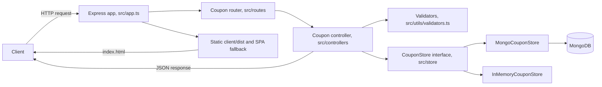
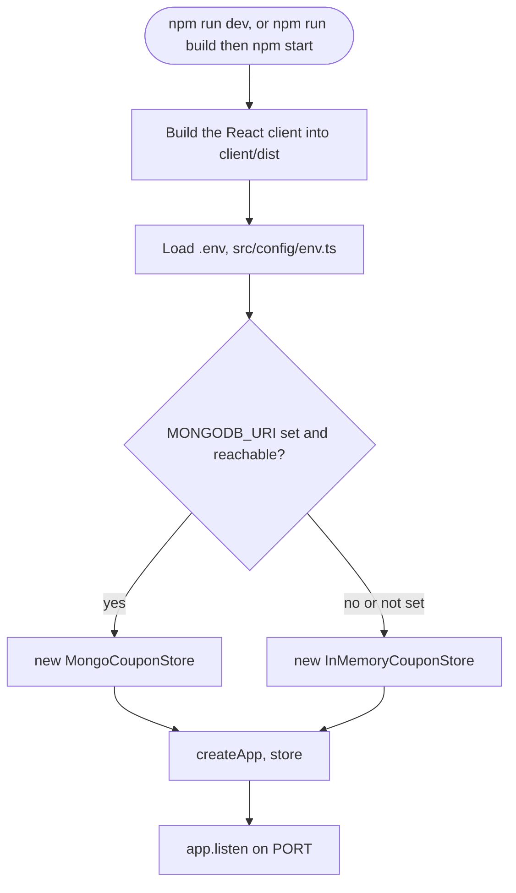

# Architecture

## Overview

The API is a small Express app written in TypeScript. It is split into the usual layers, routes, controllers and a storage layer, so that the HTTP handling, the business rules (what counts as a valid coupon, what an expired or unknown coupon looks like) and the actual data storage are not tangled together. The reasoning behind the specific choices below (Node over Bun, Mongo over Postgres, Vite over Bun's bundler) is in [docs/decisions.md](decisions.md). This file is about how the pieces fit together, not why they were picked.

## Request flow



The controller never imports Mongoose or `Map` directly, it only talks to the `CouponStore` interface. That is what makes the tests able to run the real controller and router logic against `InMemoryCouponStore` without a database anywhere in sight.

## Startup sequence



`connectMongo` (`src/db/connect.ts`) never throws on a missing or unreachable URI, it just returns `false` and logs a warning, so a missing database is never a reason the server fails to start.

## Folder structure

```
src/
  app.ts              Express app factory, used by both index.ts and the tests
  index.ts             Entry point, picks a storage backend and starts the server
  config/env.ts        Reads PORT and MONGODB_URI from the environment
  db/connect.ts         Connects to MongoDB, or reports that it could not
  models/coupon.model.ts  Mongoose schema used only by MongoCouponStore
  store/                CouponStore interface plus the Mongo and in memory implementations
  routes/               Express routers
  controllers/           Request handling and validation orchestration
  middleware/            Error handler and 404 handler
  utils/validators.ts    Small, explicit input validators
  types/coupon.ts        Shared TypeScript types

tests/                  Jest and Supertest integration tests, run against InMemoryCouponStore
client/                 Bonus React and Vite page that creates and lists coupons
docs/                   This file, decisions.md, and nothing else
```

## Error handling

Every controller function is wrapped in try/catch and forwards unexpected errors to `next(err)`, which lands in the central error handler in `src/middleware/error-handler.ts`. That handler logs the error server side and responds with a generic `{ error: "something went wrong, please try again" }` and a 500 status, so internal details (stack traces, database error messages) never leak into an API response. The one exception is a body that is not valid JSON, which `express.json()` rejects before any route runs, that gets a 400 with a clear message because it is a client error and not a server one. Expected failures (bad input, an unknown coupon code, an expired coupon, a duplicate code) are handled explicitly in the controller with a specific status code and a clear message, they never reach the generic handler.

## Why coupons round to 2 decimal places

`finalAmount` is rounded with `Math.round((amount - discountAmount) * 100) / 100` before it is sent back. Plain floating point subtraction can leave results like `6.699999999999999` for some inputs, which is not something you want to show as a price.

## Bonus frontend serving

The React frontend is built into `client/dist` and served by the Express backend itself. `express.static` mounts `client/dist` at `/`, and any route that is not an API endpoint falls back to `index.html` so the SPA can render. That means the page is available at `http://localhost:4000/` with no second dev server, and the API and the page share one origin, so the client calls the API with relative URLs.
